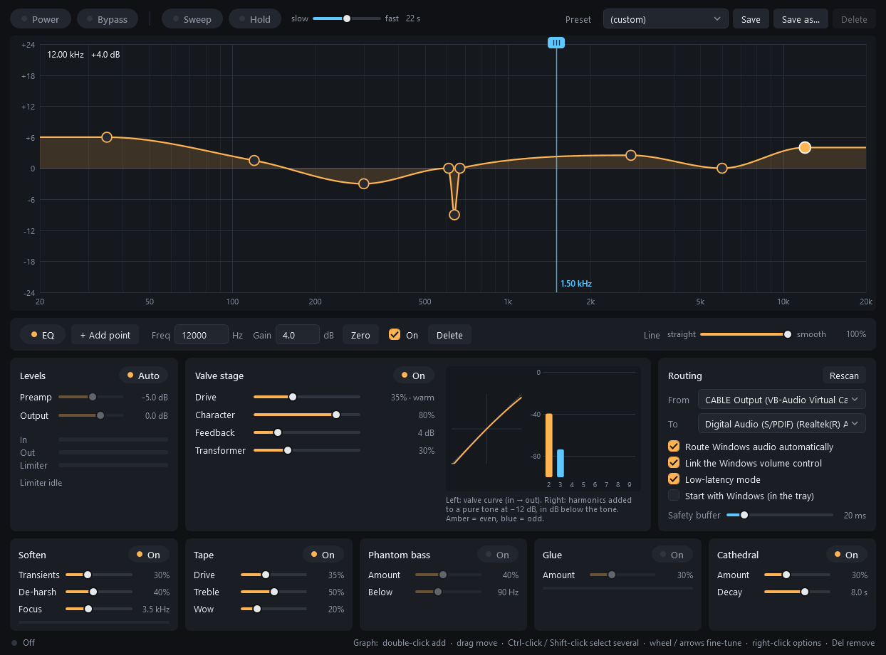

# Radiqualiser

A system-wide audio equaliser for Windows where you draw the response you want, with a valve (tube) amp stage and a
handful of other effects you can turn up as far as you like. Everything Windows plays goes through it: music players,
browsers, games.

**An Equalizer APO alternative.** Radiqualiser does not install anything into the Windows audio driver, so it can
work where Equalizer APO will not install or has stopped working after an update. The trade-off is that it needs a
virtual audio cable and adds about 50 ms of delay. See [Limits](#limits).



## What it does

**Drawn equaliser.** Double-click the graph to add a point, drag it where you want it. The line passes exactly
through every point, with as many points as you like, and stays flat beyond the first and last. A slider sets how the
line travels between points, from straight segments to a smooth curve. Ctrl-click and Shift-click select several
points to move together. The equaliser adds no delay.

**Frequency sweep.** A test tone that glides from 20 Hz to 20 kHz through your settings, with a marker on the graph you
can grab and drag to any frequency. Useful for finding the note that makes the room boom.

**Valve stage.** A model of a valve amplifier's distortion, which is where the "warm" sound comes from:

- *Drive*: how hard the music is pushed into the valve curve, from clean through hi-fi richness to outright fuzz.
- *Character*: push-pull (odd harmonics, tighter) through to single-ended triode (2nd harmonic, the classic warmth).
- *Feedback*: negative feedback, from loose and rich to tight and clean.
- *Transformer*: bass saturates first and the extreme treble rolls off, as with an output transformer.

A small display shows the valve curve and the harmonics it is adding.

**Other effects**, each with its own switch:

- *Soften*: rounds off transients, and turns harsh upper mids down only while they are harsh.
- *Tape*: tape saturation, treble that squashes when loud, and wow and flutter.
- *Phantom bass*: adds harmonics of the lowest notes so small speakers suggest bass they cannot play.
- *Glue*: a slow, gentle mix compressor.
- *Cathedral*: a long reverb, up to a 10-second stone cathedral.

**Automatic level.** Keeps the processed sound as loud as the original and under full scale, so changing a setting
changes the tone and not the volume, and nothing clips. A limiter sits at the end as a safety net.

**Presets**, a tray icon, and an option to start with Windows.

## Status

Version 0.1.0. It has been built for and tested on exactly one PC (Windows 10, optical output to an external DAC),
where it is in daily use. The signal processing has a numeric test suite; the rest has been tested by using it. Expect
rough edges on other hardware, and please report them.

## Requirements

- Windows 10 or 11, 64-bit.
- [VB-CABLE](https://vb-audio.com/Cable/), a free (donationware) virtual audio cable from VB-Audio. Radiqualiser uses
  it to pick up what Windows plays. It is a separate product and is not included here.

## Setup

1. Install VB-CABLE: download it from [vb-audio.com/Cable](https://vb-audio.com/Cable/), unzip, run
   `VBCABLE_Setup_x64.exe` as administrator, and restart the PC.
2. Download Radiqualiser from the [Releases page](https://github.com/MastaRob/Radiqualiser/releases), unzip it
   anywhere, and run `Radiqualiser.exe`. The program is not code-signed, so Windows SmartScreen may warn the first
   time: choose *More info*, then *Run anyway*.
3. In the *Routing* panel, *From* should show "CABLE Output" and *To* should be the device your speakers, headphones or
   DAC are connected to.
4. Switch *Power* on.

While Power is on, Radiqualiser makes the cable the Windows default playback device. When you switch it off or exit, it
hands the default back to your normal output. The Windows volume slider and volume keys keep working as before.

There are two downloads:

| File | Size | Needs |
|---|---|---|
| `Radiqualiser-0.1.0-win-x64.zip` | about 70 MB | nothing else |
| `Radiqualiser-0.1.0-win-x64-small.zip` | under 1 MB | the [.NET 11 Desktop Runtime](https://dotnet.microsoft.com/download/dotnet/11.0) |

For the best sound, set the cable and your output device to the same sample rate in Windows Sound settings, and set
your output device to 24-bit. Radiqualiser tells you in its status line if either is off.

## Using it

Every control has a tooltip that says what it does and what sensible settings are. A few things worth knowing:

- Double-click a slider to put it back to its default.
- On the graph: double-click adds a point, drag moves it, the mouse wheel and arrow keys fine-tune, right-click gives
  options, Del removes. While dragging, hold Shift to move up and down only, or Ctrl to move sideways only.
- *Bypass* plays the unprocessed sound for comparison.
- Closing the window keeps it running in the tray. Right-click the tray icon and choose *Exit* to quit.

Settings and presets are stored in `%AppData%\Radiqualiser`.

## Limits

- **Stereo only.** Surround sources lose everything but front left and right.
- **About 50 ms of delay** from the trip through the cable and back. Fine for music and video; you may notice it in
  rhythm games.
- **Shared mode only.** Programs that take exclusive control of a sound device (WASAPI exclusive, ASIO) go around it.
- **If the program is killed** rather than closed, Windows is left playing into the cable and you hear nothing. Start
  Radiqualiser again, or choose your normal device in Windows Sound settings. (An ordinary crash restores it.)
- Switching the default device uses an undocumented Windows interface, the same one other audio-switching tools rely on. If a
  future Windows update breaks it, untick *Route Windows audio automatically* and set the default device by hand.

## How it works

```
Windows default output → VB-CABLE → Radiqualiser → your real output device
```

Radiqualiser records from the cable's output with WASAPI, processes the audio, and plays it to the real device. The
two devices run on separate clocks, so a variable-ratio resampler nudges the rate by a few parts per million to keep
the buffer between them steady.

The processing order is: preamp, equaliser, soften, phantom bass, valve stage, tape, glue, reverb, level, limiter.

- The equaliser turns the drawn line into a 16,384-tap minimum-phase FIR filter and runs it as a partitioned
  convolution with no added latency. Changing the line crossfades to the new filter.
- The valve and tape stages run oversampled (8× at 48 kHz) so the distortion does not alias.
- Automatic level compares the loudness of the processed and unprocessed sound and trims the difference.

The source is in three projects under `src`:

| Project | Contents |
|---|---|
| `Radiqualiser.Core` | Audio engine and all signal processing. No user interface. |
| `Radiqualiser` | The WPF application. |
| `Radiqualiser.Check` | Command-line tests and device diagnostics. |

## Building

Needs the [.NET 11 SDK](https://dotnet.microsoft.com/download/dotnet/11.0) on Windows.

```
dotnet build Radiqualiser.slnx -c Release
dotnet run --project src/Radiqualiser.Check -c Release -- dsp
```

The second command runs the signal-processing tests. It makes no sound and needs no audio devices.

To build the standalone download:

```
dotnet publish src/Radiqualiser/Radiqualiser.csproj -c Release -r win-x64 --self-contained true -p:PublishSingleFile=true -p:IncludeAllContentForSelfExtract=true -p:EnableCompressionInSingleFile=true -p:DebugType=none -o release/standalone
```

## Credits and licence

Radiqualiser is released under the [MIT licence](LICENSE). It uses [NAudio](https://github.com/naudio/NAudio) by Mark
Heath for audio device access; see [THIRD-PARTY-NOTICES.md](THIRD-PARTY-NOTICES.md).

The program was designed by ear and by conversation, with [Claude Code](https://claude.com/claude-code) writing the code.
